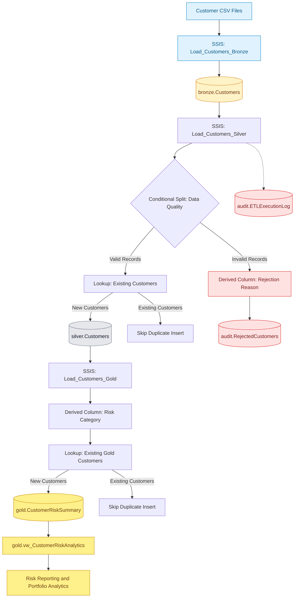

# Banking Risk Data Warehouse | SSIS ETL Pipeline

### SQL Server • SSIS • ETL • Data Quality • Banking Risk Analytics

## Project Overview

An end-to-end banking risk data engineering project using SQL Server Integration Services (SSIS) and Microsoft SQL Server.

The project demonstrates a **Bronze–Silver–Gold data warehouse architecture**, covering data ingestion, validation, error handling, audit logging, risk classification, and reporting.

## System Architecture

## Implemented SSIS Packages

| Package | Purpose |
|---|---|
| Load_Customers_Bronze.dtsx | Ingest customer CSV data into SQL Server |
| Load_Customers_Silver.dtsx | Validate records, handle duplicates, and reject invalid customers |
| Load_Customers_Gold.dtsx | Calculate risk categories and load reporting-ready customer data |

## Key Technical Features

- SSIS Data Flow and Control Flow
- OLE DB Sources and Destinations
- Conditional Split and Derived Column transformations
- Lookup transformations for duplicate prevention
- Rejected-record handling
- SQL Server ETL execution audit logging
- Bronze–Silver–Gold data modeling
- Data reconciliation and quality validation
- SQL reporting views

## Demonstrated Results

- **10,001 validated customer records** in Silver
- **10,001 customer records** in Gold
- **0 missing customer IDs** in Gold
- Successful validation of customer risk classifications

## Customer Risk Segmentation

| Credit Score | Classification |
|---|---|
| 750–850 | Low Risk |
| 650–749 | Medium Risk |
| 300–649 | High Risk |

*These thresholds are illustrative and are not a production credit risk model.*

## Technology Stack

- Microsoft SQL Server
- SQL Server Integration Services (SSIS)
- SQL Server Management Studio (SSMS)
- Visual Studio 2026
- T-SQL
- PowerShell
- Git and GitHub

## Planned Enhancements

- Loan and payment ETL pipelines
- Portfolio credit exposure analysis
- Advanced ETL error handling and reconciliation
- Incremental loading and update handling
- CI/CD and deployment automation

## Project Purpose

This project was developed as a practical demonstration of enterprise ETL development, SQL Server data warehousing, data quality controls, and banking risk reporting.
